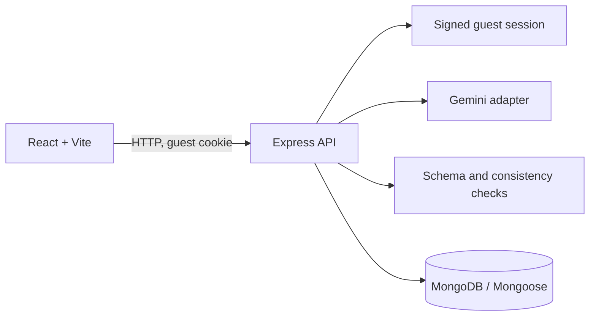

# Architecture

The API is authoritative for generation, ownership, progress and accusation evaluation. Gemini output is treated as untrusted; a case is persisted only after deterministic checks pass. Public DTOs are explicitly constructed, and only the accusation/reveal operations return the solution. The guest ID is random and held in a signed, HTTP-only, SameSite=Lax cookie. MongoDB owns the durable case record. Image media uses a labeled placeholder and CCTV uses simulation events until a real media adapter is configured.

## Runtime

- Client: React 18, Vite, React Router, Axios, Lucide React.
- API: Node ESM, Express, Mongoose, Zod, Google GenAI SDK.
- Default text model: `gemini-3.8-flash`, configurable through `GEMINI_MODEL`; requests use JSON response mode and validate the parsed result in the API.
- API prefix: `/api/v1`; default ports 5173 and 5000.

The implementation uses synchronous case generation with a bounded timeout and limited regeneration. It does not create an active record until a fully validated case is ready.
